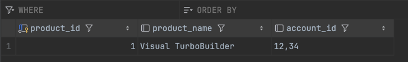

# 무단횡단

목표: 다중 값 속성 저장

테이블의 칼럼이 하나의 값을 가질 땐 설계가 쉽다. 해당 값의 인스턴스 하나를 표현하는 SQL 데이터 타입.
- 정수 / 날짜 / 문자열 같은 것을 선택. 그러나 관련된 값의 집합은 어떻게 한 칼럼에 저장할 수 있을까?

안티패턴: 쉼표로 구분된 목록에 저장.

특정 계정에 대한 제품 조회

모든 FK가 하나의 필드에 결합되어 있으면 쿼리가 어려워진다.

## 안티패턴 인식 방법

아래와 같은 말이 나온다면 무단횡단 안티패턴 사용중일 수 있다.

- "이 목록이 지원해야 하는 최대 항목 수는 얼마나 될까?"
- "SQL에서 단어의 경계를 어떻게 알아내는지 알아?"
- "이 목록에서 절대 나오지 않을 문자가 어떤게 있을까?"

### 반대로 안티패턴 사용이 합당한 경우

반정규화를 적용해 성능을 향상시켜야 할때,반정규화를 사용하기로 결정할 떄는 보수적.

정규화는 애플리케이션 코드를 좀더 융통성 있게 하고, 데이터베이스의 정합성을 유지.

## 해법은?

교차 테이블 생성

**Accounts 1...N Contacts N...1 Products**

그럼 문제가 쉽게 해결

